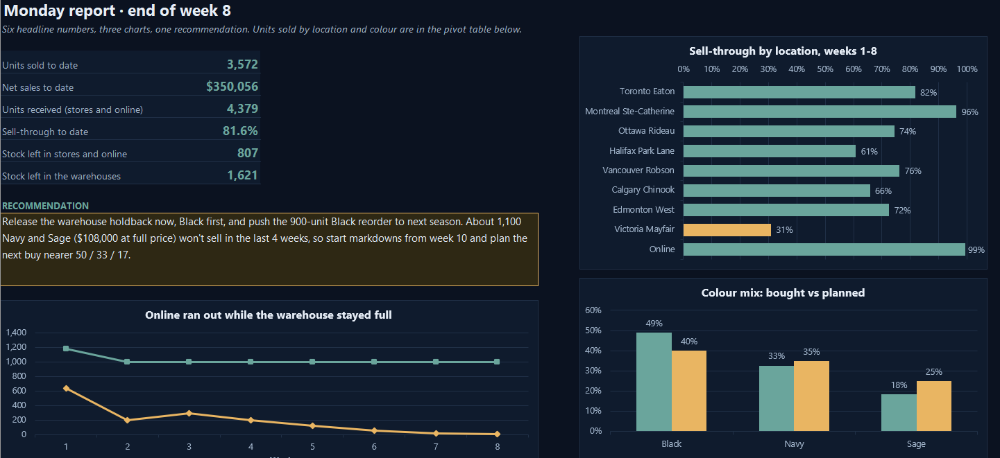
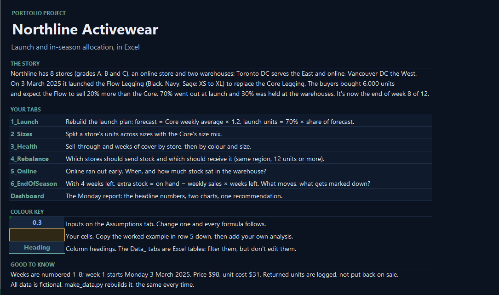
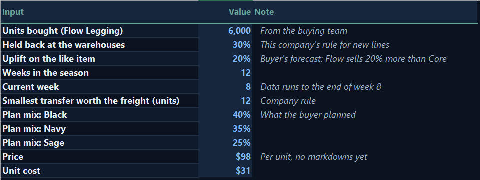
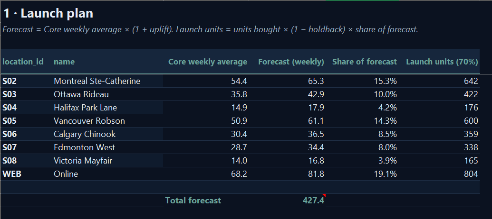
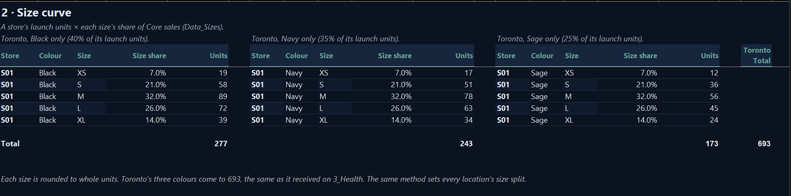
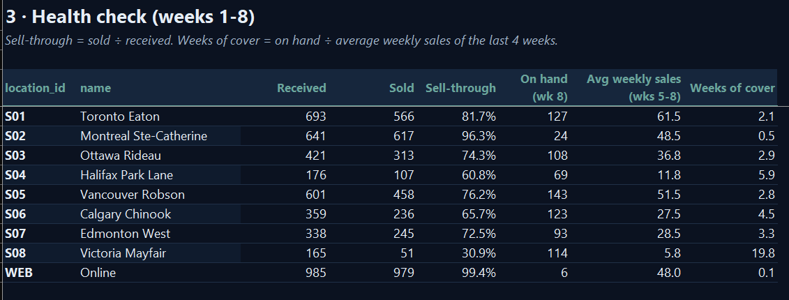
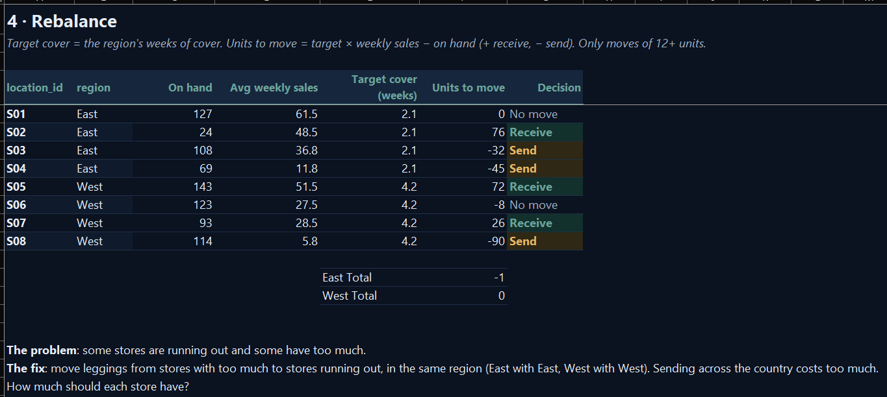
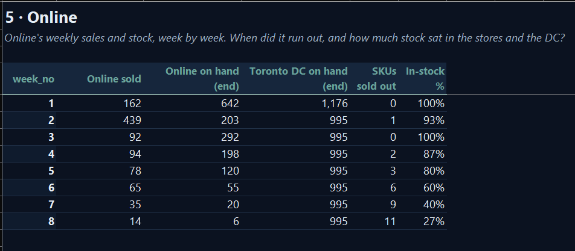
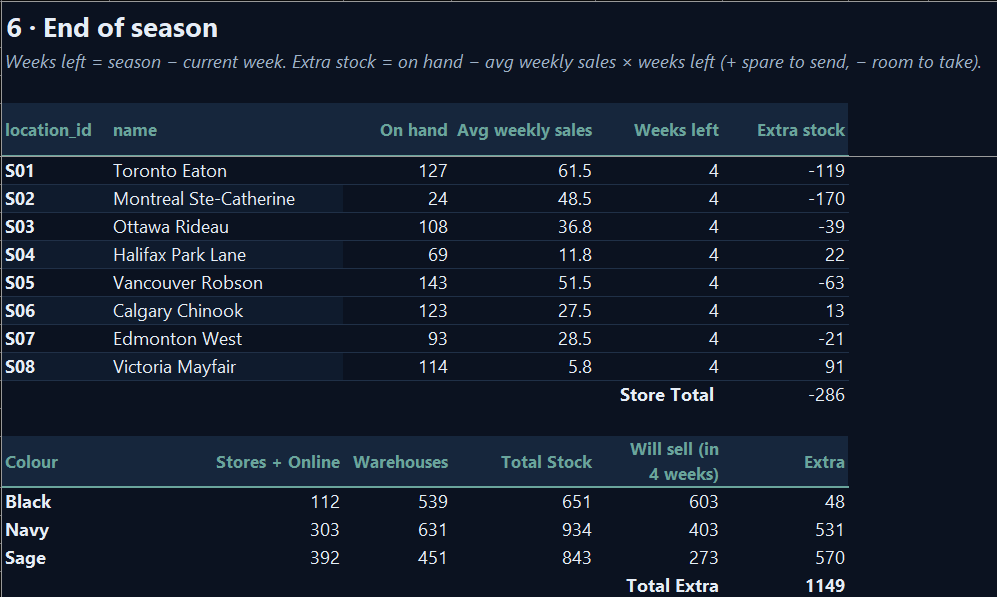
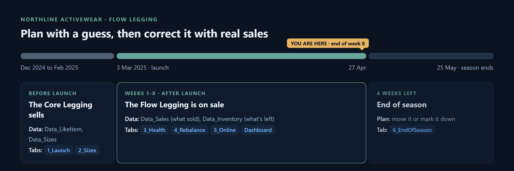

# Northline Activewear: Launch & In-Season Allocation (Excel)

**How should 6,000 units of a new product be split across 8 stores, online and 2 warehouses, and what should move once sales come in?**

A fictional Canadian activewear brand launches the Flow Legging (3 colours, 5 sizes) with no sales history. In one Excel workbook, I planned the launch allocation, built the size curve, tracked weeks 1 to 8, rebalanced stock between stores, and planned the end of season.


<!-- PLACEHOLDER: images/dashboard.png = Dashboard from A1 to the charts, without the pivot table -->

📥 **[Download the workbook](northline_allocation.xlsx)** (click it, then the download button on the right) and open it in Excel. Start on the `Start_Here` tab.

## Key findings

| | Finding | Action |
|---|---|---|
| 📦 | **Montreal** sold **96%** of its stock in 8 weeks and has **half a week** left, while **Victoria** holds nearly **20 weeks** of cover. | Moved **76** units from **Ottawa and Halifax** to **Montreal** (East) and **90** from **Victoria** to **Vancouver and Edmonton** (West). Moves stay inside each region. |
| 🎨 | **Black** sold through **94%**, **Sage** only **63%**. Customers bought **49% Black** against a plan of **40%**. | Send the **539 Black** still in the warehouses to the fastest stores, and plan the next buy nearer **50 / 33 / 17**. |
| 🌐 | Online ran out of **11 of its 15** sizes and colours by week **8** (in-stock **27%**), while **995** units sat in the Toronto warehouse from week 2 on. | Top up online from the Toronto DC **every week**, not once, so the holdback follows demand. |

**Recommendation:** Release the warehouse holdback now, Black first, and push the **900-unit Black reorder** to next season. Even then, about **1,100 Navy and Sage** (**$108,000** at full price) won't sell in the last 4 weeks, so start markdowns from week 10, and plan the next buy nearer **50 / 33 / 17**.

## Built in Excel
Pivot tables · SUMIFS / AVERAGEIF · INDEX / MATCH · IF / ROUND · conditional formatting · charts

---

## The story
Northline has 8 stores across Canada (graded A, B and C), an online store, and two warehouses: Toronto serves the East and online, and Vancouver serves the West. On 3 March 2025 it launched the Flow Legging to replace the Core Legging. The buyers bought 6,000 units and expect the Flow to sell 20% more than the Core did. 70% went out at launch, and 30% was held at the warehouses. It's now the end of week 8 of a 12-week season.

As the allocation analyst, I had to answer:

1. **Launch plan:** how many units each store and online get on day one, and how many stay at the warehouses.
2. **Size curve:** how to split each store's units across XS to XL.
3. **Health check:** sell-through and weeks of cover, by store and by colour.
4. **Rebalance:** which stores send stock and which receive it.
5. **Online:** what happened when online ran out first.
6. **End of season:** what to pull together, and what to mark down.

## The workbook: `northline_allocation.xlsx`

Open it in Excel and start on `Start_Here`. Blue cells are inputs, amber cells are my analysis. The `Dashboard` is the one-page Monday report: six KPIs, three charts, a pivot table and the recommendation.

<details>
<summary><b>Start_Here</b>: the cover page</summary>


<!-- PLACEHOLDER: images/start_here.png -->
</details>

<details>
<summary><b>Assumptions</b>: the inputs every formula uses</summary>


<!-- PLACEHOLDER: images/assumptions.png -->
</details>

<details>
<summary><b>1_Launch</b>: forecast and launch units by store</summary>


<!-- PLACEHOLDER: images/1_launch.png -->
</details>

<details>
<summary><b>2_Sizes</b>: the size curve</summary>


<!-- PLACEHOLDER: images/2_sizes.png -->
</details>

<details>
<summary><b>3_Health</b>: sell-through and weeks of cover, by store and by colour</summary>


<!-- PLACEHOLDER: images/3_health.png -->
</details>

<details>
<summary><b>4_Rebalance</b>: which stores send and which receive</summary>


<!-- PLACEHOLDER: images/4_rebalance.png -->
</details>

<details>
<summary><b>5_Online</b>: when online ran out, and in-stock % week by week</summary>


<!-- PLACEHOLDER: images/5_online.png -->
</details>

<details>
<summary><b>6_EndOfSeason</b>: extra stock by store, and by colour with the warehouses</summary>


<!-- PLACEHOLDER: images/6_end_of_season.png -->
</details>

## Data
Fictional data, made for this project, so anyone can open it and check the numbers.



| Table | What it holds |
|---|---|
| `Data_Locations` | 8 stores, online and 2 warehouses, with grade and region |
| `Data_Products` | 15 Flow SKUs (colour × size) and the Core like item |
| `Data_LikeItem` | The Core Legging's last 12 weeks, by location |
| `Data_Sizes` | The Core Legging's sales by size |
| `Data_Sales` | Units sold, sales and returns by week, location and SKU (weeks 1 to 8), plus a colour column looked up from `Data_Products` |
| `Data_Inventory` | Units received, stock on hand, in transit and on order, each week, plus the same colour column |

## Metrics used
- **Sell-through** = units sold ÷ units received
- **Weeks of cover** = stock on hand ÷ average weekly sales
- **In-stock %** = SKUs with stock ÷ SKUs ranged (15 for online)
- **Extra stock** = stock on hand − weekly sales × weeks left

## Repo layout
```
northline_allocation.xlsx   the whole project
images/                     dashboard.png and a screenshot of each tab
README.md
```
